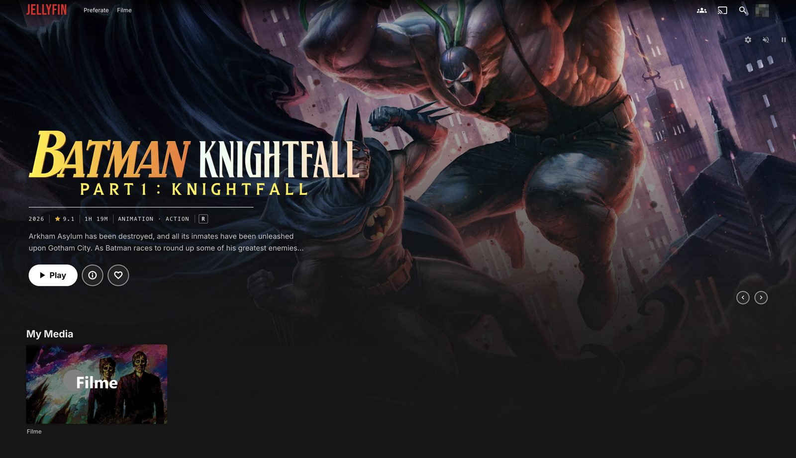
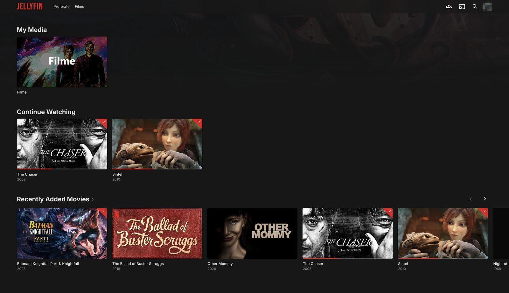
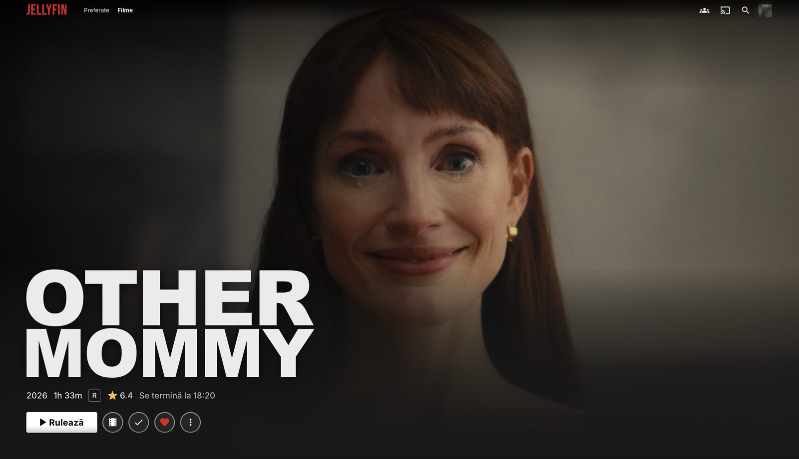
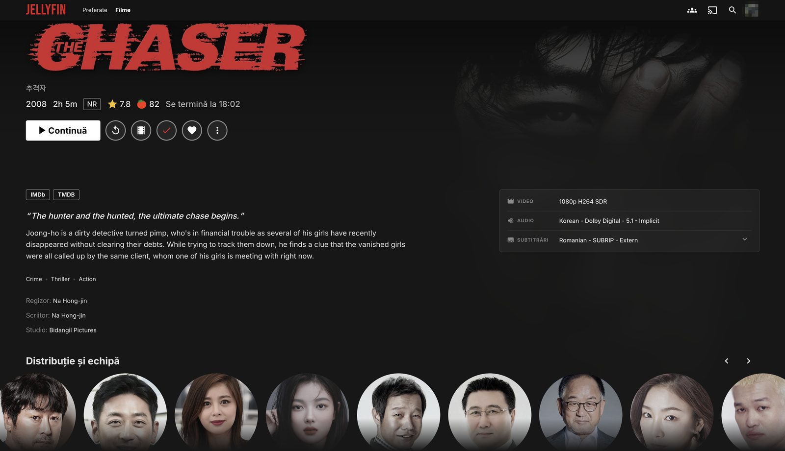
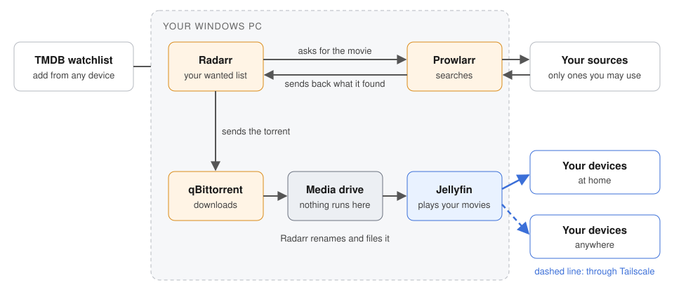

# jellyfin-windows-guide

Your own Netflix-style movie server on Windows. Watch from anywhere.

https://github.com/user-attachments/assets/070c25db-9386-4f1f-87c6-17d358b761cb

A step-by-step guide to turn a Windows PC into a movie server: your own library, a Netflix-style look, no ads, on all your devices, at home or away. Add a movie to your watchlist and it downloads, gets renamed and shows up by itself.

<details>
<summary><b>Screenshots</b></summary>

<br>

| | |
|:-:|:-:|
| <br>**Home** | <br>**Home rows** |
| <br>**Movie** | <br>**Movie details** |

</details>

## What you need

- A Windows 10 or 11 PC that can stay on. A laptop works.
- Minimum 8 GB of RAM.
- A drive for the movies. An external one is best (HDD or SSD, both work).
- 2-3 hours.
- An NVIDIA graphics card helps, but isn't required.
- No Docker, no Linux, no coding.

<details>
<summary><b>Prompt for your AI agent</b></summary>

<br>

Paste this into Claude, ChatGPT or any agent that can read web pages. It explains the guide; it doesn't run anything.

```text
Read the guide at https://github.com/tudorbaranai/jellyfin-windows-guide:
the README and every file in docs/guide/.

Only explain. Don't run commands or change anything on my computer.

Tell me, in plain words:
1. What I need before I start.
2. The steps in order, with roughly how long each takes and which
   guide part covers it. Say which parts are optional.
3. How Jellyfin, Radarr, Prowlarr, qBittorrent and Tailscale
   connect, and what each one does.
4. How I check that each step worked.
5. The mistakes people make most often, from docs/troubleshooting.md.

Keep it short. I'll ask about the parts I don't understand.
```

</details>

## Getting started

1. Install Jellyfin from [jellyfin.org](https://jellyfin.org/downloads/windows) and pick **Install as a Service** ([part 1](docs/guide/01-install-jellyfin.md)).
2. Check it's running, in PowerShell:

   ```powershell
   Get-Service JellyfinServer
   ```

   Expect `Running`. Then open `http://localhost:8096`.
3. Follow the [guide](docs/guide/README.md) in order. Every step ends with a check.

| Part | What you get |
|---|---|
| [1-4](docs/guide/README.md) | Jellyfin running, your movies in it, the GPU doing the heavy work |
| [5-6](docs/guide/05-watch-at-home.md) | Watching at home and away |
| [7-8](docs/guide/07-get-movies-automatically.md) | Movies that download and sort themselves, safely (optional) |
| [9](docs/guide/09-netflix-look.md) | The Netflix look (optional) |
| [10](docs/guide/10-everyday-use.md) | Everyday use: add a movie, update, back up |

## How it works



### What it uses

| App | Job | RAM |
|---|---|---|
| Jellyfin | Plays your movies | 300-600 MB, more while converting |
| Radarr | Keeps a list of movies you want and files them | 150-300 MB |
| Prowlarr | Searches the sources you give it | 150-300 MB |
| qBittorrent | Downloads | 100-300 MB |
| Tailscale | Lets your devices reach home from anywhere | under 100 MB |

The apps take under 2 GB of disk. The movies take the rest:

| Movie | Size |
|---|---|
| 720p | 1-2 GB |
| 1080p | 2-10 GB |
| 4K | 15-30 GB |
| Full disc copy (remux), 1080p / 4K | 20-40 / 50-80 GB |

A 1 TB drive holds about 150 movies in 1080p.

Radarr is for movies. Sonarr does the same for series; this guide doesn't cover it.

## Known limitations

- Samsung and LG TVs can't run Tailscale, so they only work at home.
- Away from home, quality depends on your home upload speed.
- One PC: when it's off or updating, the server is down.
- qBittorrent only runs while someone is logged in to Windows.
- The home-screen plugins are built for one Jellyfin version. Updating Jellyfin waits until they catch up.
- There's no built-in source for Radarr. You add your own, and only ones you have the right to use. The Internet Archive blocks Prowlarr's searches.

## Legal

This guide doesn't support piracy. Radarr, Prowlarr and qBittorrent are legal tools; the source decides whether a download is legal. Use your own discs, movies you bought, public-domain films and your own videos. The guide doesn't name or recommend any download site.

## Project files

| Path | What it is |
|---|---|
| [`docs/guide/`](docs/guide/README.md) | The guide, in ten parts |
| [`docs/troubleshooting.md`](docs/troubleshooting.md) | What breaks, and the fix |
| [`docs/glossary.md`](docs/glossary.md) | Words like direct play, bitrate, remux, Tailscale |
| [`tools/open-movies-indexer.ps1`](tools/open-movies-indexer.ps1) | Four free Blender films, to test the download pipeline |
| [`CONTRIBUTING.md`](CONTRIBUTING.md) | How to report a problem or suggest a change |

## Credits

Built on other people's work. Thank you:

| Project | By |
|---|---|
| [Jellyfin](https://github.com/jellyfin/jellyfin) | The Jellyfin team |
| [Netflin](https://github.com/ahza-code/Netflin) theme | ahza-code |
| [Media Bar](https://github.com/IAmParadox27/jellyfin-plugin-media-bar) | IAmParadox27, from the original by MakD |
| [Home Screen Sections](https://github.com/IAmParadox27/jellyfin-plugin-home-sections), [File Transformation](https://github.com/IAmParadox27/jellyfin-plugin-file-transformation), [Plugin Pages](https://github.com/IAmParadox27/jellyfin-plugin-pages) | IAmParadox27 |
| [Radarr](https://github.com/Radarr/Radarr), [Prowlarr](https://github.com/Prowlarr/Prowlarr) | The Servarr team |
| [qBittorrent](https://github.com/qbittorrent/qBittorrent) | The qBittorrent team |
| [Tailscale](https://tailscale.com) | Tailscale |
| [TMDB](https://www.themoviedb.org) | The Movie Database community |
| [awesome-jellyfin](https://github.com/awesome-jellyfin/awesome-jellyfin) | Its community, where I found most of the above |
| Big Buck Bunny, Sintel, Tears of Steel, Cosmos Laundromat | Blender Foundation |

Not affiliated with or endorsed by the Jellyfin project.

## License

MIT, see [LICENSE](LICENSE).
